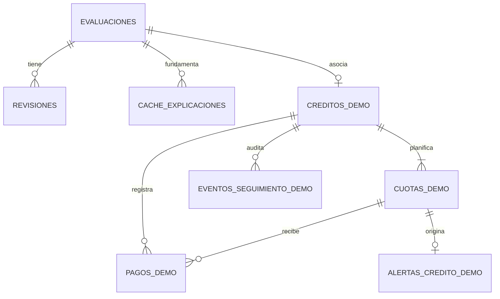

# Arquitectura y datos — NexoCredit

Corte documental: 15/10/2026, con línea base funcional y evidencias fechadas desde el 11/10/2026. La evaluación principal incorpora ahora un modelo ENIF mexicano experimental, distinto del experimento UCI y de la valoración generativa. No es un predictor validado de impagos futuros. Se conservan las evidencias históricas Azure/Power BI; no certifican servicios vigentes, producción ni datos crediticios oficiales.

## Modelo mexicano integrado

`SolicitudCredito.perfil_enif` es un objeto opcional validado con Pydantic. Contiene seis preguntas financieras y nueve posibles productos de crédito (mínimo uno); no se deduce del RFC, score o importe de deuda. El mismo `vectorizar()` genera las 25 características en entrenamiento e inferencia. El POST principal llama a `prediccion_mexico/cliente.py`, verifica SHA-256 del JSON numérico, ejecuta la regresión logística y añade `analisis_mexico` al resultado. El cliente no importa sklearn, carga pickle ni usa red. `GET /api/v1/modelo-mexico` expone metadatos y métricas con autenticación.

El repositorio existente guarda el perfil en JSONB `solicitud` y la salida ENIF completa en JSONB `resultado`; no hace falta migración. Los reintentos idempotentes recuperan el resultado original. Un perfil distinto con la misma clave da 409. El detalle/historial conserva modelo/huella/estimación/métricas de su ejecución, sin reclasificar registros anteriores. Si se selecciona ENIF y falta/cambia el artefacto, 503 sin guardar silenciosamente sólo las reglas. Si no se captura perfil, no existe `analisis_mexico` y React anuncia que sólo se aplicaron reglas.

React `PerfilMexico` forma parte de `EvaluationForm`; `ResultadoMexico` se muestra primero en `EvaluationResult` y también en `EvaluationDetail`. Su clase binaria no es Bajo/Medio/Alto: **no se sobrescribe `nivel_riesgo_preliminar`**, por lo que dashboard y vista Power BI continúan siendo comparaciones por reglas. La explicación generativa/determinista anterior sigue explicando esas reglas, no ENIF. La valoración Ollama separada tampoco decide la clase del modelo mexicano. [Ficha, métricas y limitaciones](../../inteligencia_artificial/prediccion_mexico/README.md).

## Componentes y responsabilidades

```text
Navegador React → Nginx /api → FastAPI → PostgreSQL
                   identidad ├─ Microsoft Entra (MSAL/JWT)
                             └─ Cuenta local (scrypt/JWT, revocación en DB)
FastAPI por función
  evaluación principal → reglas-demo-v2; registros v1 conservados sin recálculo
    perfil ENIF explícito → modelo mexicano JSON numérico → analisis_mexico persistido junto a reglas
    valoración automática misma captura MXN → Ollama → caché 24 h; no sobrescribe reglas
    segunda opinión opcional → escenario UCI independiente → scikit-learn local o Azure ML
  explicación → Azure OpenAI u Ollama o plantilla sin IA
  documentos → Azure AI Search o búsqueda literal local
  laboratorio UCI → mismo proveedor ML explícito (local / Azure / deshabilitado)
  economía pública → Banxico y Banco Mundial
  seguimiento → cuotas/abonos, cálculos exactos, alertas y eventos
PostgreSQL → vista limitada reportes.evaluaciones_powerbi → Power BI Desktop
Docker Compose → frontend/backend/migraciones/postgres
GitHub Actions → suites y construcción, sin publicación automática
```

Azure/Entra continúan implementados y obligatorios según el proyecto. Las alternativas locales permiten continuidad, no eliminan esos requisitos ni acreditan conectividad Azure actual. Identificadores del solicitante, comentarios y motivos de revisión no se envían a los proveedores financieros, explicativos o predictivos. La explicación recibe los hechos financieros permitidos. La inferencia UCI recibe sólo las 19 variables de su escenario independiente; la inferencia mexicana recibe únicamente el perfil ENIF explícito y opera localmente. Ninguna convierte automáticamente los seis datos MXN a otro esquema.

## Valoración generativa del mismo escenario - 15/10/2026

`ValoracionIASolicitud` comprueba estado y solicita automáticamente `POST /api/v1/evaluaciones/{UUID}/valoracion-ia` tras el guardado. El cliente sólo manda UUID; el servidor recupera la solicitud original y valida ingresos, gastos, deuda, pagos, atraso y score estrictos. Calcula margen, pagos/ingresos (%) y deuda/ingreso mensual antes de pedir a Ollama una valoración independiente. No transmite clasificación por reglas ni PII.

El contrato generativo sólo admite categoría Bajo/Medio/Alto, códigos de factores y revisiones de catálogos acotados. Las cifras y etiquetas se construyen por código con los datos originales; no se aceptan probabilidades, narración arbitraria o recomendaciones de autorizar crédito. El servidor agrega revisión humana aunque el LLM la omita. Esto limita el formato, no demuestra corrección semántica de la categoría.

Se reutilizan `cache_explicaciones` y `cuotas_explicaciones`, con hash de contrato/modelo/datos y namespace de usuario `valoracion-ia:`: éxitos 24 h, fallos un minuto, diez valoraciones/hora/cuenta independientes de explicaciones. Los locks y cuotas persisten entre procesos. Explicación y valoración comparten un límite local de dos generaciones Ollama simultáneas. No se alteran las cinco migraciones, `evaluaciones.resultado`, revisiones, dashboard o Power BI. Caché de generación no significa cambiar el resultado crediticio histórico.

El frontend deduplica por UUID durante la sesión, descarta respuestas si se cambia formulario y permite sólo reintento explícito tras un fallo. Servidor con límite de espera 180 s, cliente 200 s para carga local. Sin datos completos se rechaza con 409; sin Ollama se informa error, no se usa Azure o una plantilla automáticamente. `VALORACION_IA_PROVEEDOR=deshabilitado` impide la generación. Las integraciones Azure y el modelo UCI siguen disponibles, sin intercambiar sus variables o métricas con esta función.

## Segunda opinión UCI independiente — 15/10/2026

`SegundaOpinionModelo` / `PanelSegundaOpinion` presentan, tras el guardado, la categoría y versión originales junto a una clase del modelo académico. Las 19 entradas son independientes: `LIMIT_BAL`, `PAY_0`, `PAY_2…6`, `BILL_AMT1…6` y `PAY_AMT1…6`. Son enteros int32; límite positivo, pagos no negativos y estados de pago de −2 a 9. El usuario captura o carga un ejemplo ficticio UCI; cargarlo no consulta. No se incluyen datos demográficos, RFC/CURP, ingresos o deuda MXN del solicitante.

La API `POST /api/v1/evaluaciones/{identificador}/segunda-opinion`, en `backend/app/rutas_api/segunda_opinion.py`, exige `Depends(usuario_actual)` y reutiliza `EscenarioUCI`. El flujo es: validar UUID/cuerpo → leer evaluación existente mediante repositorio → seleccionar el proveedor ML explícito → inferir → devolver comparación temporal. La lectura de PostgreSQL se ejecuta en threadpool; no hay transacción de escritura ni llamada IA durante una operación de pago. Un UUID ausente produce 404 antes de inferir; UUID/cuerpo inválido, 422; base sin configurar/inaccesible, 503. Se conservan los errores del proveedor, sin predicción inventada ni fallback automático.

| Campo de respuesta | Procedencia y significado |
|---|---|
| `evaluacion_id` | UUID solicitado y encontrado en PostgreSQL |
| `riesgo_por_reglas`, `version_reglas` | Valores del registro original, sin ejecutar de nuevo `scoring.py` |
| `modelo` | Contrato existente del proveedor: clase booleana `incumplimiento_predicho`, origen, proveedor, modelo configurado y advertencias; metadatos locales según corresponda |
| `guardada` | Siempre `false`: ni las entradas UCI ni esta comparación se guardan |
| `advertencia` | Escenario UCI/NTD independiente, sin validación para México ni decisión crediticia |

La respuesta exitosa lleva `Cache-Control: no-store`. No se añade tabla, columna o migración, ni se modifica resultado JSONB v1/v2, revisiones, dashboard o vista Power BI. La interfaz descarta resultados de otro UUID/versión o proveedor y limpia la comparación al cambiar su contexto. El estado `GET /api/v1/ml/estado` sólo describe configuración; una etiqueta configurada no verifica la identidad del modelo remoto servido.

**Límite:** la presentación conjunta conecta el modelo con el recorrido de demostración, no con los datos financieros del solicitante. Ambos resultados corresponden a escenarios distintos, no son dos estimaciones validadas de su riesgo. El modelo local conserva artefacto SHA-256 y algoritmo, UCI/Taiwán 2005 e importes NTD; no publica probabilidad calibrada. El proveedor Azure permanece implementado con sus evidencias históricas y campos privados, sin acreditar conectividad o suscripción actual por esta actualización documental.

## Contratos y límites de confianza

REST/JSON en el mismo origen local `localhost:8080`, con `Authorization: Bearer` y controles del servidor. Entra y los tokens locales tienen claves, emisores/audiencias y mecanismos diferentes; no se interpretan como intercambiables. El local consulta cuenta/rol/versión vigente en PostgreSQL por petición; credenciales sólo en memoria del navegador y configuración privada del backend. HTTPS/TLS en proveedores externos; HTTP local no se habilita para redes públicas.

El UUID de creación/pago/atención se conserva al reintentar. El servidor comprueba cuerpo, crédito, acción y cuenta; no permite suplantar responsable. Una clave diferente no significa que sea válido duplicar un plan: `evaluacion_id` es único. Las lecturas del detalle de seguimiento usan un snapshot `REPEATABLE READ READ ONLY`. Una escritura bloquea la fila del crédito, valida saldo y confirma movimiento/eventos/alertas juntos. No hay transacciones distribuidas ni llamadas a IA dentro de esa operación.

Dinero de seguimiento: Decimal en Python, `NUMERIC(12,2)` en PostgreSQL, texto decimal en JSON y centavos BigInt en validadores React. Los cálculos previos del formulario mantienen su representación histórica, sin migración contable retrospectiva. Rango de saldos hasta 1.000.000.000, 60 cuotas y 500 pagos por plan.

## Relaciones principales



Las cuentas/contadores/cuotas de generación no contienen FK a créditos; revisiones admiten identidades históricas Entra. El evento usa huella de cuenta y responsable autenticado, no FK obligatoria a `usuarios_locales`, para soportar ambos proveedores de identidad.

## Diccionario de tablas

El esquema actual tiene doce tablas, incluida `schema_migrations`. Las migraciones SQL y OpenAPI son la referencia ejecutable; este resumen no sustituye sus restricciones.

| Tabla | Campos principales | Integridad y finalidad |
|---|---|---|
| `evaluaciones` | id UUID PK, fecha TIMESTAMPTZ, solicitud/resultado JSONB | Objetos JSON; solicitud/resultado originales, índice fecha/id |
| `revisiones` | id PK, evaluacion_id FK, version, estado, observaciones, responsable, fecha | Versión positiva única por evaluación; Pendiente/Aprobada/Rechazada demo |
| `schema_migrations` | version TEXT PK, fecha TIMESTAMPTZ | Registro de scripts aplicados bajo lock de migración |
| `usuarios_locales` | id PK, usuario único, nombre, password_hash, roles, activo, version_sesion, contadores/bloqueo, creado/actualizado | Hash scrypt con sal, sin contraseña recuperable; no cuenta predeterminada |
| `auth_intentos_locales` | origen_hash PK, inicio/cantidad, inicio_total/cantidad_total | HMAC de origen, ventanas separadas de fallos y ráfagas |
| `cache_explicaciones` | evaluacion_id FK + clave PK, respuesta JSONB o error_http/error_detalle, vence | Caché 24 h/errores 1 min; vencimiento no elimina automáticamente |
| `cuotas_explicaciones` | usuario_hash PK, inicio, cantidad positiva | Diez intentos/hora; reserva confirmada antes del proveedor |
| `creditos_demo` | id PK, evaluacion_id FK único, concepto, fecha_apertura, monto_total_pactado, plan JSONB, creado, alertas_revisadas | Un plan por evaluación; total positivo hasta 1.000.000.000 |
| `cuotas_demo` | id PK, credito_id FK, vencimiento, importe | Fecha única por crédito; par id/credito_id único para FK de pagos |
| `pagos_demo` | id PK, credito_id FK, cuota_id, fecha_pago, importe, registrado | FK compuesta asegura cuota del crédito; saldo/fecha validados bajo lock |
| `alertas_credito_demo` | id PK, credito_id FK, cuota_id FK único, tipo, estado, saldo, dias_atraso, version, observaciones, detectada/actualizada | CUOTA_VENCIDA; versión positiva; Pendiente/Atendida/Resuelta |
| `eventos_seguimiento_demo` | id PK, credito_id FK, accion, actor_hash, responsable, datos JSONB, fecha | Escritura junto al movimiento; índice crédito/fecha/id; sin endpoint de edición |

Los checks SQL controlan tipos/rangos locales. La suma del plan y los pagos que no superan saldo son invariantes del servicio transaccional, no checks SQL entre filas. Modificaciones manuales SQL pueden saltarse ese servicio: no son un flujo soportado de edición.

## Migraciones y permisos

001 evaluaciones; 002 revisiones; 003 identidad local; 004 controles y explicación; 005 seguimiento. 005 es aditiva: no reescribe ni genera créditos/pagos para evaluaciones antiguas. Los roles Docker de aplicación y lector de reportes siguen separados. No se conceden permisos de las tablas nuevas al lector Power BI ni a PUBLIC.

Power BI conserva la vista de evaluaciones existente. No se agregó automáticamente una página de créditos o medidas del ledger al PBIP: esa ampliación queda separada. No publica RFC, observaciones o eventos de identidad mediante nuevas vistas analíticas.

## Seguridad, fallos y operación

Validación Pydantic, contratos React, fechas reales, límites de página y mensajes saneados; secretos en `infraestructura/contenedores_docker/.env`, excluido de Git. Nunca incluir valores de llaves en ejemplos, logs, capturas o OpenAPI exportada.

Analista conserva captura/revisión/seguimiento; Administrador añade lectura de la auditoría global nueva. El resto de rutas mantiene sus facultades anteriores. No es RBAC productivo completo ni auditoría de todas las lecturas. La IP/NAT todavía puede compartir límites de acceso. Backend/DB en loopback; no exponer a Internet.

Antes de una migración: respaldo privado, ensayo temporal, suites, actualización local y conteos/fingerprints. Ante fallo: no borrar volumen ni rotar credenciales a ciegas; seguir [runbook](../manuales/MANTENIMIENTO_Y_SOPORTE.md). Retención/cifrado productivos, MFA, monitoreo permanente y datasets autorizados no quedan implementados por este documento.

## Adenda local ML — 12/10/2026

Esta adenda conserva el estado del laboratorio del 12/10/2026. Desde el 13/10/2026 la evaluación principal utiliza `reglas-demo-v2` para escenarios nuevos, sin modificar el modelo UCI ni sus métricas. No hay migración: los JSON v1 y su respuesta idempotente conservan resultado y versión. La explicación recupera DEM-02 por versión; catálogo local tres guías/quince secciones, pendiente de carga cloud. El frontend redondea resúmenes a pesos sin alterar datos originales. [Reglas principales, importes y límites](../manuales/REGLAS_RIESGO_DEMO.md).

El laboratorio UCI ahora selecciona explícitamente Azure ML, modelo logístico scikit-learn local o deshabilitado. Se conserva el corte anterior como evidencia histórica. FastAPI `/api/v1/ml/*` y alias `/api/v1/azure-ml/*` exigen la misma identidad autorizada; React muestra **Laboratorio IA** y las métricas según proveedor. Los proveedores de explicación/documentos continúan siendo independientes.

El adaptador local lee un JSON numérico incluido en la imagen, verifica su SHA-256/contrato y calcula la clase académica sin red ni deserialización de objetos. No almacena entradas/resultados, tiene 19 variables UCI/NTD distintas de las solicitudes principales y no requiere una tabla, migración, llave o servicio Ollama. La autenticación local mantiene su lectura de cuenta en PostgreSQL, pero el modelo no escribe la base. Si falta o se altera el artefacto falla cerrado con 503, no invoca Azure como fallback. [Entrenamiento y contrato](../../inteligencia_artificial/prediccion_local/README.md), [operación](../manuales/LABORATORIO_IA_LOCAL.md).
